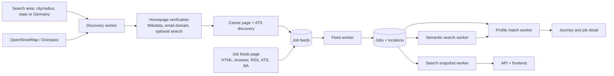

# Architecture

Radius discovers German employers, finds their public career pages and job feeds,
keeps those postings current, and ranks them against a saved profile. It also
tracks applications and can prepare application documents through a connected
ChatGPT subscription. This page describes how the pieces fit together; the
[README](../README.md) covers setup and user-facing behavior.

## Processes

One application image runs every process. Compose starts each as its own
container (`docker/entrypoint.py --api` or `--worker <module>`); in local
development, run the same modules with `python -m hiring_scraper.app.<module>`.

| Process | Module | Responsibility |
| --- | --- | --- |
| Migrations | `--migrate` | Prepares the database role and applies Alembic migrations before anything else starts. |
| API | `app.api` | FastAPI HTTP API and the built React frontend. Reads cached data only; it never crawls or runs model inference inside a request. |
| Feed worker | `app.worker` | Leases due job feeds one at a time, fetches them, and saves new, changed and closed postings. Seeds the default RSS sources. |
| Discovery worker | `app.discovery_worker` | Runs search-area campaigns: finds employers from OpenStreetMap, resolves missing homepages, and discovers career pages and ATS feeds. |
| Search snapshot worker | `app.search_snapshot_worker` | Rebuilds materialized job-search snapshots so browsing does not wait for ranking. |
| Semantic search worker | `app.semantic_search_worker` | Hosts the pinned local multilingual E5 embedding model and indexes companies and jobs. |
| Profile match worker | `app.profile_match_worker` | Rebuilds stale profile matches using local rules, local semantic evidence and queued subscription-backed AI assessments. |
| Application preparation worker | `app.application_preparation_worker` | Drafts, reviews and revises application documents from the PostgreSQL queue. |

On SQLite, profile matching runs synchronously and application preparation uses
file-backed jobs in the API process, so local development only needs the feed worker
(plus the optional search and semantic workers described in the README).

## Data flow

## Code layout

- `hiring_scraper/` — source adapters and pure logic that does not depend on the database:
  - Fetching: `http.py` (bounded, paced, SSRF-checked requests), `crawl_policy.py`,
    `challenges.py` (bot/CAPTCHA detection, never solved), `browser.py` (headless Chromium).
  - Discovery: `location_discovery.py`, `website_discovery.py`, `osm_websites.py`,
    `discovery.py`, `pages.py`, `geography.py`.
  - Job extraction: `ats.py` (Greenhouse, Lever, Personio, Ashby, Recruitee,
    SmartRecruiters, RSS/Atom), `html_jobs.py`, `regional.py` (BA Jobsuche).
  - Matching: `matching.py`, `requirements.py`, `duty_evidence.py`,
    `task_alignment.py`, `semantic_matching.py`; `election_data.py` for optional city context.
- `hiring_scraper/app/` — persistence, API routers, workers and application preparation.
  `models.py` is shared by SQLite and PostgreSQL/PostGIS; schema changes ship as
  Alembic migrations in `app/migrations/versions/` and as additive SQLite
  initialization in `database.py`.
- `frontend/` — React + TypeScript + Vite single-page app.
- `extensions/application-companion/` — Chrome extension that fills application
  forms from a saved profile. It never submits a form.
- `runtime/codex/` — pinned Codex CLI bundled for ChatGPT subscription access.
- `fixtures/` — sanitized data for the seed command, CI smoke test and manual demos.

## Invariants

- **Closure only after complete scans.** A job closes only when a successful,
  complete scan omits it. Failed, blocked, partial, rolling or geographically
  filtered reads never close jobs. A reappearing job reopens the same record.
- **Untrusted URLs.** Source URLs are restricted to public HTTP(S) hosts; each
  redirect is rechecked, and response size, redirects, time and request counts are bounded.
- **No access-control evasion.** The scanner identifies itself, paces each origin,
  honors `Retry-After`, and stops on bot challenges or logins.
- **Separate company and job geography.** Companies match an area by their
  mapped establishment; jobs match by work location or explicit remote eligibility.
  City and state searches show these independently.
- **Provenance over guesses.** Homepages, employers and locations keep their source
  evidence; unknown values stay unknown. A shared domain alone does not merge employers.
- **Reads never infer.** API requests use cached matches and assessments; model calls
  run in workers, outside database transactions, and publish only if inputs are unchanged.
- **Profile data stays private.** Prompts use saved career facts, not inferred
  abilities; profile photos are never sent to the model.

## Testing

Python tests in `tests/` exercise the SQLite path and run with
`python -m unittest discover -s tests`. The extension and application browser suite in
`tests/application_companion/` needs `RADIUS_EXTENSION_BROWSER_TESTS=1` and runs as two
CI shards. Node checks for the frontend and extension are listed in `scripts/ci/check.sh`.
The `tests/frontend_*_browser.py` scripts are manual end-to-end checks against an isolated
preview started with `scripts/dev/preview.sh`; they read the preview URLs from
`APPLICATION_TEST_WEB_URL` and `APPLICATION_TEST_API_URL`. PostgreSQL-specific
concurrency and migration checks run through `scripts/ci/postgres-local.sh` or the
container pipeline. See the [CI guide](ci.md).
