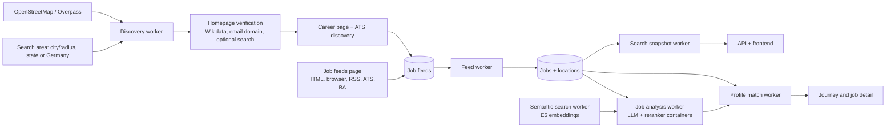

# Architecture

Radius discovers German employers, finds their public career pages and job feeds,
keeps those postings current, and ranks them against a saved profile. It also
tracks applications and can prepare application documents through a connected
ChatGPT subscription. This page describes how the pieces fit together; the
[README](../README.md) covers setup and user-facing behavior.

## Processes

One application image runs every process. Compose starts each as its own
container (`docker/entrypoint.py --api` or `--worker <module>`); in local
development, run the same modules with `python -m hiring_scraper.app.<module>`.

| Process | Module | Responsibility |
| --- | --- | --- |
| Migrations | `--migrate` | Prepares the database role and applies Alembic migrations before anything else starts. |
| API | `app.api` | FastAPI HTTP API and the built React frontend. Reads cached data only; it never crawls or runs model inference inside a request. |
| Feed worker | `app.worker` | Leases due job feeds one at a time, fetches them, and saves new, changed and closed postings. Seeds the default RSS sources. |
| Discovery worker | `app.discovery_worker` | Runs search-area campaigns: finds employers from OpenStreetMap, resolves missing homepages, and discovers career pages and ATS feeds. |
| Search snapshot worker | `app.search_snapshot_worker` | Rebuilds materialized job-search snapshots so browsing does not wait for ranking, and backfills stale precomputed Germany/state job scope columns (`job_location_scope.py`) in bounded batches. |
| Semantic search worker | `app.semantic_search_worker` | Hosts the pinned local multilingual E5 embedding model and indexes companies and jobs. |
| Job analysis worker | `app.job_analysis_worker` | Drains the job analysis and pair evidence queues with the local `llm` and `llm-reranker` containers (see `docs/local-models.md`). |
| Model containers | `llm`, `llm-reranker` | llama.cpp servers for the pinned Qwen3.5-4B (posting analysis) and Qwen3-Reranker-0.6B (CV evidence checks). CPU only. |
| Profile match worker | `app.profile_match_worker` | Scores profiles against jobs from stored analyses and evidence (no inference) and rebuilds stale matches. |
| Application preparation worker | `app.application_preparation_worker` | Runs inference and PDF rendering on separate threads with independent PostgreSQL queues. |

PostgreSQL (with PostGIS and pgvector) is the only database. Development and tests use
the same migrated schema and the same workers as production; requests never match,
prepare documents or build search snapshots inline.

## Data flow

## Code layout

- `hiring_scraper/` — source adapters and pure logic that does not depend on the database:
  - Fetching: `http.py` (bounded, paced, SSRF-checked requests), `crawl_policy.py`,
    `challenges.py` (bot/CAPTCHA detection, never solved), `browser.py` (headless Chromium).
  - Discovery: `location_discovery.py`, `website_discovery.py`, `osm_websites.py`,
    `discovery.py`, `pages.py`, `geography.py`.
  - Job extraction: `ats.py` (Greenhouse, Lever, Personio, Ashby, Recruitee,
    SmartRecruiters, RSS/Atom), `html_jobs.py`, `regional.py` (BA Jobsuche).
  - Matching: `job_analysis.py` (posting lines, LLM prompt and grammar, grounding of quotes),
    `matching_v3/` (CV evidence units, reranker evidence, additive scorer and calibration),
    `gates/` (eligibility: language, work permit, on-site, excluded titles, credentials),
    `requirements.py` (sentence scoping), `matching.py` (job enrichment and skill vocabulary for
    display) and `semantic_matching.py` (pinned E5 model identity). `election_data.py` supplies
    optional city context.
- `hiring_scraper/documents/` — database-free CV and letter schemas, marked TeX and
  DOCX import, marked-text projection, evidence, grounding and editorial checks.
- `hiring_scraper/app/` — persistence, API routers, workers and application preparation.
  `models.py` is the schema; changes ship as Alembic migrations in
  `app/migrations/versions/` (plus the rollback-safe step in `docker/entrypoint.py`,
  which `scripts/dev/migrate.py` and the test harness apply too). Write sites declare source changes through
  `source_changes.py`, which invalidates caches, queues rematching and publishes search generations. Routers live beside their domain: `journey.py`
  (stages, Journey list, momentum), `focus.py` (Today's focus), `profiles.py`,
  `companion.py`, `application_documents_v2.py`; `api.py` keeps search, companies,
  feeds and discovery.
- `frontend/` — React + TypeScript + Vite single-page app.
- `extensions/application-companion/` — Chrome extension that fills application
  forms from a saved profile. It never submits a form.
- `runtime/codex/` — pinned Codex CLI bundled for ChatGPT subscription access.
- `fixtures/` — sanitized data for the seed command, CI smoke test and manual demos.

## Application preparation

The applicant confirms the imported base CV in the chosen language. The profile
stores the structured source in `ProfileCV.variants[language].document` alongside
marked text for the matcher and companion. The editor and bundled Vite
`print.html` entry use the same React document views. Chromium loads the print
bundle through intercepted local assets, verifies the extracted PDF text and
reports page fill and overflow. Preparation uses these observations in Full review.
Editorial heuristics pass through to review as findings. Structural violations,
high-severity grounding checks and unsupported CV qualifiers can trigger retries.

| Table | Key and purpose |
| --- | --- |
| `application_document_preparation_tasks` | Profile and job. One active inference task per pair, with kind `prepare` or `revise`, lease, attempts, retry timestamp and input-digest checkpoints. |
| `application_documents` | Profile, job, kind and version. Stores the document JSON, findings, provenance and staleness. Keeps the latest 20 versions per kind. |
| `application_document_renders` | Document key and template. Stores verified PDF bytes, page count and checks. |
| `application_render_tasks` | Document key and template. Tracks the independent render lane, with a claim time, lease token and failure code. |

Preparation publishes the CV and letter as the stages complete. A revision returns
a suggestion for explicit acceptance. Automatic preparation uses the same queue
for high-ranked New jobs once the base CV is confirmed. Inference retries
transient task failures after two and ten minutes, for up to three attempts.

A PDF download returns a cached version or queues a render and returns 202.
The worker's dedicated render thread runs independently of inference. Transient
render failures retry after 15 and 60 seconds. Applicants can retry an exhausted
export from the editor.

Removing the base CV clears the profile's inference tasks and document versions,
including each version's render task and cached PDF by cascade. The companion
fills saved profile facts and can capture employer form questions. See the
[application preparation guide](application-preparation.md).

## Invariants

- **Closure only after complete scans.** A job closes only when a successful,
  complete scan omits it. Failed, blocked, partial, rolling or geographically
  filtered reads never close jobs. A reappearing job reopens the same record.
- **Untrusted URLs.** Source URLs are restricted to public HTTP(S) hosts; each
  redirect is rechecked, and response size, redirects, time and request counts are bounded.
- **No access-control evasion.** The scanner identifies itself, paces each origin,
  honors `Retry-After`, and stops on bot challenges or logins.
- **Separate company and job geography.** Companies match an area by their
  mapped establishment; jobs match by work location or explicit remote eligibility.
  City and state searches show these independently.
- **Provenance over guesses.** Homepages, employers and locations keep their source
  evidence; unknown values stay unknown. A shared domain alone does not merge employers.
- **Reads never infer.** API requests use cached matches; local model inference (job analysis,
  evidence checks, embeddings) and application drafting run in workers, outside database
  transactions, and publish only if inputs are unchanged. The job detail API reads the
  posting analysis and its queue state independently of the profile match.
- **Profile data stays private.** Application prompts use saved career facts, not inferred
  abilities; profile photos are never sent to the model.

## Concurrency model

Several processes write to the same PostgreSQL database. Keep these rules when adding writes:

- **Sources lock only source rows.** Feed, discovery and enrichment writers lock the job
  rows they change, in id order (`models.reserve_job_source_rows`), and never write
  `user_profiles`. The one exception is retiring jobs that have saved Journey stages: it
  holds the owning profiles `FOR SHARE` (through `before_publish`) while closing them.
- **Declare every source change.** After editing jobs, feeds, companies, profiles or
  model outputs, call the matching `source_changes.*_changed()` function before
  commit. It drops caches whose inputs changed and queues rematching. Undeclared tracked
  writes fail tests (strict mode) and log an error in production. Precomputed Germany/state
  location scope columns (`job_location_scope.py`) fall back to live predicates when the
  version is stale or a dirty mark exists. A change to `jobs.location_text` clears the
  version in that row's update. Structured location edits enqueue a mark per job and
  transaction in `job_location_scope_dirty`, which has no foreign key to jobs. The
  snapshot worker recomputes scopes and clears the marks visible in the same SQL snapshot,
  then services queued refreshes between backfill batches.
- **Derived data is rebuilt from queues.** A declared job change is queued in `match_dirty_jobs` and, when its text
  changed or it was never analysed, in `job_analysis_queue`; companies and jobs needing search vectors are queued
  in `semantic_search_refreshes` by database triggers. Published analyses and changed CV evidence units queue pairs in
  `match_evidence_queue`. Workers drain these queues. Only profile-wide scoring inputs
  (career/matching preferences, `low_afd_vote_share_weight`, `search_area`, CV career facts, or the matcher version)
  mark a whole profile stale via `_profile_index_version`.
- **Presentation defaults avoid full rebuilds.** Changing only `matching_defaults.min_match_score` or
  `matching_defaults.include_unknown` does not change `_profile_index_version` or clear `profile_job_matches`; saving those
  fields calls `source_changes.profile_changed(..., presentation_only=True)` (bumping `source_version` to serialize against
  in-flight workers without touching `match_index_version`) and runs
  `reevaluate_profile_new_applications`, which shares `application_match_allowed` with the
  workers, leaves user-decided stages untouched, and defers dirty/stale/legacy rows to `match_dirty_jobs` (`ON CONFLICT DO
  NOTHING`).
- **One match computation, single-snapshot reads, and version-stamped explanations.** Indexers (`job_search.py`) and
  read fallbacks (`search_snapshots.py`, `journey.py`) share `match_compute.compute_match` (gates + stored analysis and evidence).
  Every `profile_job_matches` upsert stores a JSONB-safe (NUL/surrogate/non-finite stripped) `explanation` bounded to
  `<= 16 KiB` on the final `json.dumps(..., allow_nan=False)` wire bytes (including `requirement_observations` and
  `local_context.city_election_results`), stamped with internal provenance `_stamp` (`job` revision and `sem`, the analysis and evidence hashes;
  stripped before returning) and `score_version` (`current_score_version()`) with
  `explanation['score'] == match_score`. Read paths validate `profile_job_matches`, `match_dirty_jobs`, `user_profiles`
  and the `job_analyses`/`match_evidence` hashes
  in ONE consistent SQL statement (`load_stored_match_snapshots`) for only the displayed `(profile_id, job_id)` pairs,
  loading model output payloads only on fallback. Indexed search treats a missing `profile_job_matches` row as an
  authoritative `profile_conflict` only when the profile index is current and the job is not dirty, and recomputes via
  `compute_match` otherwise. Journey keeps rank and card score consistent, local-only: stale/dirty rows with a faithful
  stored explanation render the same ranked stored card flagged `'refreshing': True` (with `matching_pending = True`);
  rows without a faithful stored explanation keep their stored rank order — rendering a neutral `'refreshing': True`
  card from the stored rank (or no score card when unranked) instead of recomputing or re-sorting on the displayed page,
  while the profile match worker supplies the local explanation.
- **Profiles are versioned, not locked by publishers.** Profile edits bump
  `user_profiles.source_version` (through `source_changes`). Publishers of per-profile data
  record the versions when they start, compute without locks, then call
  `models.hold_profiles(session, {id: version}, wait=False)` before their derived writes.
  It holds the rows `FOR SHARE` (publishers run side by side; edits wait) and raises
  `ProfileIndexChanged` if a version moved or an edit is in flight; the work is retried.
  The match worker passes expected versions.
- **Lock order is jobs → profiles → derived rows.** Lock affected job rows first
  (`reserve_job_source_rows`), then hold profiles, then write matches or Journey rows.
  Profile editors write the profile row before derived rows, so neither side
  can deadlock. Hold exclusively (`exclusive=True`) only to write the profile row itself.
- **Preparation publishes with a fenced lease.** Inference renews its six-minute
  lease through stage/checkpoint updates and periodic worker checks. Publication
  holds the job and profile before the task row and verifies the lease token
  and task ID before updating document versions. Retry waits keep the task active
  until its next claim time. The render lane takes the document version before
  the render task, verifies its two-minute lease token and publishes PDF bytes
  against that exact version and template.
- **Document versions use compare-and-set.** An editor saves against its observed
  version. If another writer wins, the API returns 409 and the editor keeps the
  local text. Preparation publishes over the version it started from or a
  version it published itself. Otherwise it keeps the generated document with
  the task so the applicant can review and adopt it explicitly. Input changes
  during inference mark the result stale. CV saves and profile changes can mark
  existing versions stale. CV removal takes the profile row before clearing
  tasks and document versions, so expired workers cannot recreate them.
- **Retry contention, don't discard work.** Wrap persistence of expensive results in
  `database.retry_transient()`, and log loop failures with `database.log_worker_failure()`
  (one warning line for contention, a traceback for bugs).
- **No unbounded periodic scans.** Poll loops must do O(batch) work when idle. Backfills
  use bounded id windows and stop once complete; the job analysis worker only reads its
  own queues, so an idle cycle costs O(1).
  `tests/test_postgres_idle_cost.py` measures every worker's idle cycle at two inventory
  sizes and fails if its cost grows; add new poll loops to it.

## Matcher v3

Matching is local and model-based; the static keyword matchers (v1, v2) are removed.
`docs/local-models.md` describes the pipeline. In short: a local LLM lists each posting's
duties and requirements as verbatim, line-cited quotes (benefits and company text are
never items); a local reranker checks each item against the closest CV lines, reading
the job's occupation and industry; `matching_v3.score` adds five evidence components,
bounded penalties and a DEV-fitted monotone calibration.

A job without a usable analysis or pair evidence is `pending`: stored with score 0,
never turned into a Journey New card, and shown as analysing. After an edit, the
previous analysis (status `stale`) and evidence stay in use until replaced; evidence
is only joined to the exact analysis revision it was computed for.

Visible language and work authorization flags can deduct up to two points combined.
The matcher hides a job only when it can cite an explicit incompatibility in both
the posting and saved profile. Stored explanations include gate citations, the
contribution ledger and calibration within the same 16 KiB limit. When space is
tight, the projection shortens quotes while preserving contribution totals.

The evaluation (`tests/eval`) scores from recorded model outputs, so CI needs no
models; regenerate them after a model, prompt or query change.

## Testing

Every database test runs on PostgreSQL through `tests/pg.py`: it migrates the database
in `TEST_POSTGRES_URL` once per run (real triggers, generated columns and indexes) and
empties every table before each test. `pg.isolated_engine()` gives migration and DDL
tests a private schema; `pg.run_workers()`, `pg.list_jobs()` and `pg.list_applications()`
drain the worker queues the way production does before a test reads results. Run the
suite with `scripts/dev/postgres-sandbox.sh` (a throwaway local cluster),
`scripts/ci/postgres-local.sh` (an existing local test server) or `scripts/ci/run.sh`. The extension and application browser suite in
`tests/application_companion/` needs `RADIUS_EXTENSION_BROWSER_TESTS=1` and runs as two
CI shards. Node checks for the frontend and extension are listed in `scripts/ci/check.sh`.
The `tests/frontend_*_browser.py` scripts are manual end-to-end checks against an isolated
preview started with `scripts/dev/preview.sh`; they read the preview URLs from
`APPLICATION_TEST_WEB_URL` and `APPLICATION_TEST_API_URL`. `tests/test_postgres_*.py`
cover concurrency, lock ordering and idle worker cost. See the [CI guide](ci.md).
